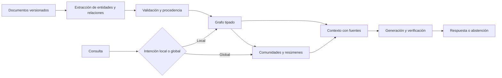

## Propósito

Complementar la recuperación por chunks cuando la respuesta depende de relaciones, comunidades o patrones distribuidos.

## Problema y fuerzas

RAG vectorial recupera pasajes locales y puede fallar en preguntas globales que exigen síntesis sobre todo el corpus.

El patrón debe equilibrar calidad, coste, latencia, gobierno, reproducibilidad, seguridad y capacidad de evolución.

## Solución

Extraer entidades/relaciones, construir comunidades o subgrafos, resumir estructura y recuperar contexto graph-aware.

> **RGA:** la investigación no encontró «RGA» como acrónimo normalizado de una técnica única. Se conserva GraphRAG / Graph-Augmented Generation como nombre canónico.

## Estructura

Separar **contrato**, **estado/configuración**, **motor de decisión** y **evidencia observable**. Las integraciones con modelos, stores, motores de datos o frameworks ML quedan detrás de adapters explícitos.

## Flujo

1. Validar precondiciones y configuración.
2. Construir o seleccionar el artefacto requerido.
3. Ejecutar la decisión bajo límites explícitos.
4. Registrar métricas, lineage y errores.
5. Validar el resultado antes de promoción o consumo aguas abajo.

## Implementación del repositorio

La implementación TypeScript es una referencia pedagógica de los invariantes del patrón. No reproduce automáticamente los sistemas, kernels, benchmarks o infraestructuras descritos en la literatura.

## Cuándo utilizarlo

Cuando el problema descrito sea recurrente y exista capacidad para observar sus trade-offs. En sistemas críticos, acompañarlo de autorización, evaluación, regresión y rollback.

## Cuándo no utilizarlo

Cuando una solución más simple ya satisfaga el problema o cuando no exista evidencia/telemetría suficiente para justificar la complejidad adicional.

## Fallos, seguridad y gobierno

Extracción incorrecta, graph drift, coste de indexado, hallucinated edges y exceso de contexto.

## Observabilidad y evaluación

Faithfulness, cobertura de entidades/relaciones, calidad local/global, coste de indexado y latencia.

Las métricas deben asociarse a dataset, modelo, hardware, versión y procedimiento reproducible.

## Evidencia y alcance

La evidencia primaria/oficial se registra mediante: `edge-2024-graphrag`. Sus resultados o garantías quedan limitados al alcance de las fuentes.

## Relaciones

Relacionados: 25, 37, 41, 109, 111.  
Composición frecuente: 52, 66, 77, 98, 109.

## Diseño de referencia: recuperación local y global

**Consulta local.** Identificar entidades de la pregunta, resolverlas contra un vocabulario versionado y recuperar vecinos por aristas autorizadas con profundidad máxima, presupuesto de tokens y procedencia por relación. Devolver fragmentos fuente y no solo nombres de nodos.

**Consulta global.** Recuperar resúmenes de comunidades vinculados a una versión del corpus; seleccionar los relevantes y sintetizar una respuesta con atribución a documentos originales. Los resúmenes son artefactos derivados, no sustituyen a las fuentes.

**Ruta de degradación.** Si falla el grafo, caduca el índice o la cobertura es insuficiente, devolver una respuesta limitada con recuperación textual o abstenerse; nunca convertir ausencia de evidencia en una afirmación.

## Contratos e invariantes verificables

| Contrato | Invariante | Prueba mínima |
|---|---|---|
| Ingesta | Cada documento tiene ID, versión y huella | Reingesta idempotente de un mismo snapshot |
| Extracción | Toda arista conserva fuente y extractor | Rechazar una relación sin procedencia |
| Recuperación | El usuario solo ve nodos y documentos autorizados | Consulta cruzada entre dos ámbitos de acceso |
| Síntesis | Cada afirmación verificable se vincula a evidencia recuperada | Inyectar una relación inexistente y exigir abstención |
| Reproducibilidad | Consulta, índice, modelo y parámetros quedan identificados | Reejecutar un conjunto de evaluación congelado |
| Actualización | Cambios de corpus invalidan artefactos derivados afectados | Modificar un documento y comprobar invalidación |

El ejemplo `src/pattern_110_graphrag.ts` únicamente ilustra vecinos y resúmenes. **No implementa** extracción, control de acceso, atribución, comunidades, persistencia ni síntesis con LLM. Esas capacidades requieren adaptadores y pruebas independientes.

## Laboratorio reproducible

1. Preparar un corpus pequeño con documentos de dos ámbitos de acceso, relaciones multihop y preguntas locales/globales; guardar versiones y respuestas de referencia.
2. Construir tres rutas sobre el mismo corpus: búsqueda textual/vectorial, recorrido de grafo y recuperación híbrida.
3. Ejecutar las mismas preguntas y registrar contexto recuperado, citas, abstenciones, latencia, tokens y coste.
4. Introducir errores controlados: arista falsa, entidad ambigua, documento revocado y resumen desactualizado.
5. Comparar por estratos de pregunta y publicar también los casos en los que la ruta simple supera a GraphRAG.

### Métricas y criterios de aceptación propuestos

- **Retrieval:** recall@k de evidencia, precisión de entidades y aristas y cobertura de preguntas multihop.
- **Respuesta:** exactitud con rúbrica humana, atribución verificable, tasa de afirmaciones sin soporte y abstención apropiada.
- **Operación:** latencia p50/p95, tokens por respuesta, coste por consulta, coste de indexación y frescura del índice.
- **Seguridad:** fugas entre ámbitos de acceso y tasa de éxito de inyección en documentos recuperados.

No se fijan umbrales universales: se deben predefinir para cada caso de uso, junto con tamaño muestral, procedimiento de anotación e intervalos de incertidumbre. Las comparaciones requieren mismo corpus, preguntas y presupuesto de evaluación.

## Decisiones y antipatrón específico

Elegir **RAG simple** para consultas puntuales con evidencia local suficiente. Elegir **GraphRAG** si las relaciones y las preguntas globales aportan valor medible. Considerar el **router 111** cuando coexistan tipos de consulta y la selección dinámica compense su coste.

**Antipatrón — arista alucinada como verdad:** aceptar sin verificación una relación extraída por LLM y usarla como fundamento de la respuesta. Mitigación: procedencia, validación de tipos, revisión de relaciones de alto impacto y citas al documento original.

## Límites de evidencia

La referencia `edge-2024-graphrag` respalda el planteamiento estudiado por sus autores; no demuestra superioridad general frente a cualquier RAG, modelo, corpus o carga. Las métricas y el laboratorio anteriores son **propuestas de evaluación**, no resultados experimentales obtenidos por este repositorio.
