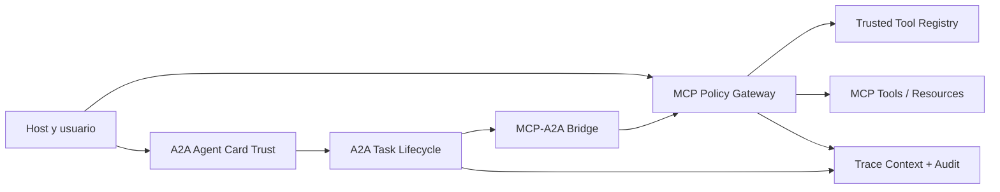

# P8 — Doce patrones candidatos de interoperabilidad agéntica

> **Estado editorial:** fichas de diseño en investigación, todavía no catalogadas como implementaciones. No modificar el recuento 122 ni el baseline de evidencia hasta que existan TypeScript, tests y gates verdes. Fecha: 2026-11-20.

## Regla de clasificación

MCP y A2A son protocolos, no patrones por sí mismos. Cada entrada describe una solución arquitectónica recurrente. Las capacidades de las especificaciones se consideran insumos normativos; el diseño del patrón es una propuesta de este proyecto. Verificar solapamientos con IDs 5, 28, 57, 65, 69, 72, 77, 98 y 103 antes de asignar IDs.

## P8-01 — MCP Capability Adapter

**Problema.** Diferencias entre SDKs y versiones.

**Solución y responsabilidades.** Adaptador con contratos de entrada/salida, versionado y validación de esquema. Separar transporte, identidad, decisión, ejecución y auditoría; rechazar por defecto los estados ambiguos.

**Contratos de prueba.** Validar esquemas y versiones; registrar actor, operación, decisión, correlación y resultado; probar específicamente: Versión incompatible; schema inválido; herramienta desconocida.

**Observabilidad.** Conformidad por versión, errores de contrato, latencia. Registrar dataset, versión de protocolo, SDK, política, entorno y límites de confianza.

**Antipatrón.** Confundir compatibilidad nominal con conformidad probada, o interpretar texto remoto como instrucciones privilegiadas.

**Composición.** Gateway de políticas + registro confiable + trazabilidad; para delegación entre agentes, A2A lifecycle + puente MCP–A2A.

**Estado de evidencia.** Diseño propuesto, sin benchmark propio ni garantía empírica universal.

## P8-02 — MCP Policy Gateway

**Problema.** Acceso directo a herramientas sin control central.

**Solución y responsabilidades.** Gateway con autorización por identidad, nombre, argumentos y efectos. Separar transporte, identidad, decisión, ejecución y auditoría; rechazar por defecto los estados ambiguos.

**Contratos de prueba.** Validar esquemas y versiones; registrar actor, operación, decisión, correlación y resultado; probar específicamente: Scope insuficiente; tenant cruzado; efecto de escritura.

**Observabilidad.** Denegaciones correctas, falsas denegaciones, trazas. Registrar dataset, versión de protocolo, SDK, política, entorno y límites de confianza.

**Antipatrón.** Confundir compatibilidad nominal con conformidad probada, o interpretar texto remoto como instrucciones privilegiadas.

**Composición.** Gateway de políticas + registro confiable + trazabilidad; para delegación entre agentes, A2A lifecycle + puente MCP–A2A.

**Estado de evidencia.** Diseño propuesto, sin benchmark propio ni garantía empírica universal.

## P8-03 — Trusted Tool Registry

**Problema.** Metadatos de herramientas no confiables.

**Solución y responsabilidades.** Registro curado, pinning de procedencia, caducidad y revisión. Separar transporte, identidad, decisión, ejecución y auditoría; rechazar por defecto los estados ambiguos.

**Contratos de prueba.** Validar esquemas y versiones; registrar actor, operación, decisión, correlación y resultado; probar específicamente: Tool poisoning; suplantación de nombre; rotación de clave.

**Observabilidad.** Cobertura de procedencia, rechazos maliciosos. Registrar dataset, versión de protocolo, SDK, política, entorno y límites de confianza.

**Antipatrón.** Confundir compatibilidad nominal con conformidad probada, o interpretar texto remoto como instrucciones privilegiadas.

**Composición.** Gateway de políticas + registro confiable + trazabilidad; para delegación entre agentes, A2A lifecycle + puente MCP–A2A.

**Estado de evidencia.** Diseño propuesto, sin benchmark propio ni garantía empírica universal.

## P8-04 — Explicit Workflow Handle

**Problema.** Estado oculto en sesiones de transporte.

**Solución y responsabilidades.** Handles de negocio explícitos con TTL, dueño, revocación e idempotencia. Separar transporte, identidad, decisión, ejecución y auditoría; rechazar por defecto los estados ambiguos.

**Contratos de prueba.** Validar esquemas y versiones; registrar actor, operación, decisión, correlación y resultado; probar específicamente: Handle expirado, reutilizado o de otro usuario.

**Observabilidad.** Recuperación, idempotencia, fugas. Registrar dataset, versión de protocolo, SDK, política, entorno y límites de confianza.

**Antipatrón.** Confundir compatibilidad nominal con conformidad probada, o interpretar texto remoto como instrucciones privilegiadas.

**Composición.** Gateway de políticas + registro confiable + trazabilidad; para delegación entre agentes, A2A lifecycle + puente MCP–A2A.

**Estado de evidencia.** Diseño propuesto, sin benchmark propio ni garantía empírica universal.

## P8-05 — MRTR Human Elicitation

**Problema.** Herramientas necesitan datos humanos a mitad de ejecución.

**Solución y responsabilidades.** Pausar, solicitar input y reanudar con respuesta correlacionada. Separar transporte, identidad, decisión, ejecución y auditoría; rechazar por defecto los estados ambiguos.

**Contratos de prueba.** Validar esquemas y versiones; registrar actor, operación, decisión, correlación y resultado; probar específicamente: Consentimiento denegado; respuesta tardía; repetición.

**Observabilidad.** Tasa de reanudación, tiempo de aprobación. Registrar dataset, versión de protocolo, SDK, política, entorno y límites de confianza.

**Antipatrón.** Confundir compatibilidad nominal con conformidad probada, o interpretar texto remoto como instrucciones privilegiadas.

**Composición.** Gateway de políticas + registro confiable + trazabilidad; para delegación entre agentes, A2A lifecycle + puente MCP–A2A.

**Estado de evidencia.** Diseño propuesto, sin benchmark propio ni garantía empírica universal.

## P8-06 — Host-Controlled Sampling

**Problema.** Servidor remoto pretende controlar inferencia.

**Solución y responsabilidades.** El host conserva políticas de modelos, contexto, coste y autorización. Separar transporte, identidad, decisión, ejecución y auditoría; rechazar por defecto los estados ambiguos.

**Contratos de prueba.** Validar esquemas y versiones; registrar actor, operación, decisión, correlación y resultado; probar específicamente: Exfiltración de contexto; bucles; sobrecoste.

**Observabilidad.** Tokens, coste, rechazos, fuga de datos. Registrar dataset, versión de protocolo, SDK, política, entorno y límites de confianza.

**Antipatrón.** Confundir compatibilidad nominal con conformidad probada, o interpretar texto remoto como instrucciones privilegiadas.

**Composición.** Gateway de políticas + registro confiable + trazabilidad; para delegación entre agentes, A2A lifecycle + puente MCP–A2A.

**Estado de evidencia.** Diseño propuesto, sin benchmark propio ni garantía empírica universal.

## P8-07 — A2A Agent Card Trust

**Problema.** Descubrimiento de agentes sin garantías de identidad.

**Solución y responsabilidades.** Validación de Agent Card, endpoints, interfaces y firmas cuando proceda. Separar transporte, identidad, decisión, ejecución y auditoría; rechazar por defecto los estados ambiguos.

**Contratos de prueba.** Validar esquemas y versiones; registrar actor, operación, decisión, correlación y resultado; probar específicamente: Card alterada; endpoint falso; versión incompatible.

**Observabilidad.** Tasa de verificación y resolución. Registrar dataset, versión de protocolo, SDK, política, entorno y límites de confianza.

**Antipatrón.** Confundir compatibilidad nominal con conformidad probada, o interpretar texto remoto como instrucciones privilegiadas.

**Composición.** Gateway de políticas + registro confiable + trazabilidad; para delegación entre agentes, A2A lifecycle + puente MCP–A2A.

**Estado de evidencia.** Diseño propuesto, sin benchmark propio ni garantía empírica universal.

## P8-08 — A2A Task Lifecycle

**Problema.** Delegaciones largas sin estados coherentes.

**Solución y responsabilidades.** Máquina de estados, taskId/contextId, cancelación y artefactos. Separar transporte, identidad, decisión, ejecución y auditoría; rechazar por defecto los estados ambiguos.

**Contratos de prueba.** Validar esquemas y versiones; registrar actor, operación, decisión, correlación y resultado; probar específicamente: Duplicados; cancelación tardía; tarea huérfana.

**Observabilidad.** Finalización, recuperación, transiciones ilegales. Registrar dataset, versión de protocolo, SDK, política, entorno y límites de confianza.

**Antipatrón.** Confundir compatibilidad nominal con conformidad probada, o interpretar texto remoto como instrucciones privilegiadas.

**Composición.** Gateway de políticas + registro confiable + trazabilidad; para delegación entre agentes, A2A lifecycle + puente MCP–A2A.

**Estado de evidencia.** Diseño propuesto, sin benchmark propio ni garantía empírica universal.

## P8-09 — MCP–A2A Bridge

**Problema.** Confusión entre invocar herramientas y delegar agentes.

**Solución y responsabilidades.** Adaptador explícito de identidad, scopes, resultados y fallos. Separar transporte, identidad, decisión, ejecución y auditoría; rechazar por defecto los estados ambiguos.

**Contratos de prueba.** Validar esquemas y versiones; registrar actor, operación, decisión, correlación y resultado; probar específicamente: Privilegios ampliados; pérdida de correlación.

**Observabilidad.** Trazabilidad extremo a extremo, errores. Registrar dataset, versión de protocolo, SDK, política, entorno y límites de confianza.

**Antipatrón.** Confundir compatibilidad nominal con conformidad probada, o interpretar texto remoto como instrucciones privilegiadas.

**Composición.** Gateway de políticas + registro confiable + trazabilidad; para delegación entre agentes, A2A lifecycle + puente MCP–A2A.

**Estado de evidencia.** Diseño propuesto, sin benchmark propio ni garantía empírica universal.

## P8-10 — Tool Poisoning Defense

**Problema.** Instrucciones hostiles en descripciones y resultados.

**Solución y responsabilidades.** Separación datos/instrucciones, revisión y política de efectos. Separar transporte, identidad, decisión, ejecución y auditoría; rechazar por defecto los estados ambiguos.

**Contratos de prueba.** Validar esquemas y versiones; registrar actor, operación, decisión, correlación y resultado; probar específicamente: Inyección en descripción, salida, recurso.

**Observabilidad.** Éxito del ataque, falsos positivos. Registrar dataset, versión de protocolo, SDK, política, entorno y límites de confianza.

**Antipatrón.** Confundir compatibilidad nominal con conformidad probada, o interpretar texto remoto como instrucciones privilegiadas.

**Composición.** Gateway de políticas + registro confiable + trazabilidad; para delegación entre agentes, A2A lifecycle + puente MCP–A2A.

**Estado de evidencia.** Diseño propuesto, sin benchmark propio ni garantía empírica universal.

## P8-11 — Argument-Aware Least Privilege

**Problema.** Autorización basada solo en nombre de herramienta.

**Solución y responsabilidades.** Decisión por sujeto, recurso, argumento y efecto. Separar transporte, identidad, decisión, ejecución y auditoría; rechazar por defecto los estados ambiguos.

**Contratos de prueba.** Validar esquemas y versiones; registrar actor, operación, decisión, correlación y resultado; probar específicamente: Parámetro destructivo; ruta no autorizada.

**Observabilidad.** Denegación correcta por caso adversarial. Registrar dataset, versión de protocolo, SDK, política, entorno y límites de confianza.

**Antipatrón.** Confundir compatibilidad nominal con conformidad probada, o interpretar texto remoto como instrucciones privilegiadas.

**Composición.** Gateway de políticas + registro confiable + trazabilidad; para delegación entre agentes, A2A lifecycle + puente MCP–A2A.

**Estado de evidencia.** Diseño propuesto, sin benchmark propio ni garantía empírica universal.

## P8-12 — Cross-Protocol Trace Context

**Problema.** Pérdida de causalidad entre hosts, tools y agentes.

**Solución y responsabilidades.** Propagación de traceId, spanId, taskId con redacción de secretos. Separar transporte, identidad, decisión, ejecución y auditoría; rechazar por defecto los estados ambiguos.

**Contratos de prueba.** Validar esquemas y versiones; registrar actor, operación, decisión, correlación y resultado; probar específicamente: Saltos sin trazas; IDs repetidos; datos sensibles.

**Observabilidad.** Completitud de trazas, cardinalidad, exposición. Registrar dataset, versión de protocolo, SDK, política, entorno y límites de confianza.

**Antipatrón.** Confundir compatibilidad nominal con conformidad probada, o interpretar texto remoto como instrucciones privilegiadas.

**Composición.** Gateway de políticas + registro confiable + trazabilidad; para delegación entre agentes, A2A lifecycle + puente MCP–A2A.

**Estado de evidencia.** Diseño propuesto, sin benchmark propio ni garantía empírica universal.

## Diagrama de composición

## Fuentes y límites

- MCP 2026-07-28, anuncio y cambios normativos: https://blog.modelcontextprotocol.io/posts/2026-07-28/
- MCP, overview: https://github.com/modelcontextprotocol/modelcontextprotocol/blob/main/docs/specification/2026-07-28/basic/index.mdx
- A2A Agent Card, especificación: https://a2a-protocol.org/latest/specification/agent-card/
- A2A y registro de agentes: https://docs.cloud.google.com/agent-registry/a2a-protocol
- Revisión bibliográfica, límites y fuentes secundarias: [INTEROPERABILIDAD_AGENTES_MCP_A2A_2026.md](../INTEROPERABILIDAD_AGENTES_MCP_A2A_2026.md)

La especificación MCP 2026-07-28 emplea núcleo sin sesiones, MRTR y extensiones. No asumir compatibilidad automática con clientes previos. A2A define Agent Cards y ciclo de tareas; no implica que toda tarjeta sea confiable ni que toda delegación esté autorizada.

## Gates para promoción al catálogo

Para cada entrada: asignar ID estable, metadata válida, fichero `src/pattern_N_*.ts`, export en `src/index.ts`, script `pattern:N`, ficha `content/patterns/N-*.md`, referencias con `scopeNote`, pruebas de seguridad y regresión. Actualizar de forma atómica catálogo, taxonomía, README, libros y web. Validar consistencia, evidencia, editorial, publicaciones, build y CI. No modificar baseline por mera existencia de una especificación.
